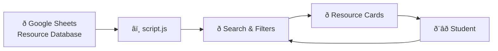

<div align="center">

<!-- ANIMATED HEADER -->
<a href="https://icse-cbse-10-12.github.io/icse-class-10-materials/">
  
</a>

<br>

<!-- TYPING ANIMATION -->
<a href="https://icse-cbse-10-12.github.io/icse-class-10-materials/">
  
</a>

<br>

<!-- BADGES -->

[](https://icse-cbse-10-12.github.io/icse-class-10-materials/)
[](https://www.youtube.com/@ICSEMasterClass10)
[](https://t.me/ICSEMasterClass10)
[](LICENSE)

<br><br>

### 📚 One Place. Every Subject. Better Preparation.

**A free digital study vault built for ICSE Class 10 students.**

</div>

---

## 🚀 Welcome to ICSE MasterClass

> **Stop searching. Start studying.**

ICSE MasterClass brings important Class 10 learning resources together in one organized digital vault.

Instead of spending hours searching across different websites, PDFs, videos and folders, students can quickly **find → open → study → practise → improve**.

---

## ⚡ The Learning Journey

```text
             📚 FIND
                │
                ▼
        🔎 SEARCH / FILTER
                │
                ▼
          📖 SELECT
                │
                ▼
          👀 PREVIEW
                │
                ▼
          📥 STUDY
                │
                ▼
          ✍️ PRACTICE
                │
                ▼
           📝 TEST
                │
                ▼
          🔍 ANALYSE
                │
                ▼
          🎯 IMPROVE
                │
                └───────────────↺
```

### 🔥 The goal

**Less time finding resources → More time actually learning.**

---

## 🌐 Open the Vault

<div align="center">

### 🎓 [ENTER ICSE MASTERCLASS](https://icse-cbse-10-12.github.io/icse-class-10-materials/)

<br>

**📚 Study Materials**  
**📝 Question Banks**  
**📄 Previous Year Questions**  
**📑 Sample Papers**  
**📖 Notes & Reference Material**  
**🎥 Video Lectures**

</div>

---

# 🎯 What You Can Find

| Resource | Purpose |
|---|---|
| 📚 **Notes** | Learn and revise concepts |
| 📝 **Question Banks** | Build question-solving ability |
| 📄 **PYQs** | Understand previous exam patterns |
| 📑 **Sample Papers** | Practise complete papers |
| 📖 **Reference Books** | Explore additional material |
| 🎥 **Video Lectures** | Learn concepts visually |
| ⭐ **Special Notes** | Quick revision and focused preparation |
| 🏛️ **Official CISCE Materials** | Access relevant official resources |

---

# 🧠 Built Around How Students Actually Study

### 01 — Learn

Understand the concept.

⬇️

### 02 — Practise

Solve questions immediately.

⬇️

### 03 — Test

Attempt structured questions and papers.

⬇️

### 04 — Analyse

Find weak areas.

⬇️

### 05 — Improve

Revise specifically where you need it.

---

# 📚 Subjects

The vault is organized around the subjects available in the project.

### 🔬 Science

- ⚡ Physics
- 🧪 Chemistry
- 🧬 Biology

### ➗ Mathematics

- Mathematics

### 🌍 Humanities

- 🏛️ History & Civics
- 🌏 Geography
- 🌱 Environmental Applications

### 💻 Applications & Commerce

- 💻 Computer Applications
- 💼 Commercial Studies
- 📊 Commercial Applications
- 💰 Economic Applications
- 🏠 Home Science
- 🏃 Physical Education

### 📖 Languages

- 📘 English Language
- 📕 English Literature
- 🇮🇳 Hindi
- 🌴 Malayalam
- 🌿 Tamil
- 🌳 Kannada

### 📦 Other

- Other Subjects

---

# 🔎 Smart Resource Discovery

The website is designed around **searching and filtering instead of endless scrolling**.

```text
Choose Subject
      ↓
Choose Category
      ↓
Filter Resources
      ↓
Find What You Need
      ↓
Open Material
```

For example:

```text
Physics
   ↓
Question Banks
   ↓
Chapter / Topic
   ↓
Select Resource
   ↓
Study
```

---

# 🏗️ How The Vault Works



### Simple architecture

**Google Sheets → JavaScript → Search/Filter → Resource Cards → Student**

This makes it possible to update resources without manually rebuilding every resource card on the website.

---

# 📂 Repository Structure

```text
icse-cbse-10-12-icse-class-10-materials/
│
├── 📄 README.md
├── 🚫 404.html
├── 🔐 google15cd0558d5c0d3f8.html
├── 🏠 index.html
├── ⚖️ LICENSE
├── 📱 manifest.json
├── 🤖 robots.txt
├── ⚙️ script.js
├── 🗺️ sitemap.xml
├── 🎨 style.css
└── ⚡ sw.js
```

---

# 🧩 File Responsibilities

| File | Purpose |
|---|---|
| `index.html` | Main vault interface |
| `style.css` | Custom visual styling |
| `script.js` | Resource loading, filtering and interaction |
| `manifest.json` | Progressive Web App configuration |
| `sw.js` | Service worker / PWA functionality |
| `robots.txt` | Search-engine crawling instructions |
| `sitemap.xml` | Search-engine discovery |
| `404.html` | Custom missing-page experience |
| `google15cd0558d5c0d3f8.html` | Google verification |
| `LICENSE` | Source-code licensing |
| `README.md` | Project documentation |

---

# 📱 Install It Like an App

The project includes **Progressive Web App functionality**.

That means supported devices can install the vault and access it more like an application.

```text
🌐 Open Website
       ↓
📱 Install
       ↓
🎓 ICSE MasterClass
       ↓
📚 Study Vault
```

The project includes:

- `manifest.json`
- `sw.js`
- Service-worker registration
- PWA installation handling
- Standalone app configuration

---

# 🎨 Design Philosophy

The interface follows a premium educational visual language:

```text
┌─────────────────────────────────────────────┐
│                                             │
│        🎓 ICSE MASTERCLASS                  │
│                                             │
│       Dark • Premium • Focused              │
│                                             │
│        🟨 Amber Accent                      │
│        ⬜ Clear Typography                   │
│        🟦 Deep Navy Background              │
│                                             │
└─────────────────────────────────────────────┘
```

### Core visual direction

- 🌑 Deep navy / dark interface
- 🟨 Amber-gold accent
- ⬜ High-contrast typography
- 🧊 Glass-style cards
- 📱 Responsive design
- 🎓 Education-first interface

---

# 🔗 The ICSE MasterClass Ecosystem

```text
                    🎓
             ICSE MASTERCLASS
                    │
       ┌────────────┼────────────┐
       │            │            │
       ▼            ▼            ▼
   🌐 WEBSITE    ▶️ YOUTUBE    💬 TELEGRAM
       │            │            │
       ▼            ▼            ▼
   Resources     Lectures      Community
   & Notes       & Concepts    & Support
```

### 🌐 Website

Central study-material vault.

### ▶️ YouTube

Concept explanations, One Shots, revision and exam-focused content.

### 💬 Telegram

Resources, updates, support and community communication.

---

# 📖 Recommended Study Workflow

### Before a chapter

```text
📚 Read the concept
        ↓
🎥 Watch explanation
        ↓
📝 Make / review notes
```

### During preparation

```text
✍️ Solve questions
        ↓
📄 Attempt PYQs
        ↓
📝 Attempt sample papers
```

### Before examination

```text
🔁 Revise
   ↓
🧠 Active recall
   ↓
⏱️ Timed practice
   ↓
🔍 Analyse mistakes
   ↓
🎯 Fix weak areas
```

---

# 💡 The ICSE MasterClass Philosophy

<div align="center">

## ❌ Don't collect resources.

## ✅ Use them.

<br>

### Finding a PDF is not preparation.

### Understanding → Practising → Testing → Analysing

### **That is preparation.**

</div>

---

# ⚡ Why This Project Exists

Students often lose valuable study time because useful material is scattered across:

- Search engines
- PDFs
- Drive folders
- YouTube
- Different websites
- Messaging groups
- Reference books

ICSE MasterClass aims to make the discovery process simpler.

> **One organized vault. Multiple learning resources. One clear goal: better preparation.**

---

# 🤝 Community

<div align="center">

### 🎓 ICSE MasterClass

**Learn. Practise. Improve.**

<br>

[▶️ YouTube](https://www.youtube.com/@ICSEMasterClass10)

[💬 Telegram](https://t.me/ICSEMasterClass10)

[🌐 Study Vault](https://icse-cbse-10-12.github.io/icse-class-10-materials/)

</div>

---

# 🛠️ Technology

The project uses a lightweight web stack:

```text
HTML
 │
 ├── Tailwind CSS
 │
 ├── Custom CSS
 │
 ├── Vanilla JavaScript
 │
 ├── Google Sheets
 │
 └── Progressive Web App
```

No heavy frontend framework is required for the core vault.

---

# 🔐 Legal & Copyright Notice

ICSE MasterClass is an independent educational project.

The website aggregates and organizes educational resources that are publicly available online. ICSE MasterClass does **not** claim to be the original author, publisher or copyright owner of third-party materials.

Third-party:

- 📚 Books
- 📄 PDFs
- 🖼️ Publisher material
- ™️ Trademarks
- 🏷️ Brand names
- 📖 Excerpts

remain the intellectual property of their respective owners.

ICSE MasterClass is **not affiliated with, endorsed by, or officially associated with CISCE**.

For copyright or takedown concerns:

📧 **icsemasterclass@gmail.com**

Valid removal requests are reviewed according to the project's stated takedown policy.

---

# 📜 License

The **source code** of this project is released under the **MIT License**.

See [`LICENSE`](LICENSE) for details.

> ⚠️ The MIT License applies to the project's source code, not automatically to third-party educational materials or copyrighted resources linked/aggregated by the website.

---

# 🌟 Final Goal

<div align="center">

## 📚 Learn

↓

## ✍️ Practise

↓

## 📝 Test

↓

## 🔍 Analyse

↓

## 🎯 Improve

<br>

### **ICSE MasterClass**

### *Study Smarter. Search Less. Achieve More.* 🚀

<br>

<a href="https://icse-cbse-10-12.github.io/icse-class-10-materials/">

</a>

</div>


---

# Complete User Guide and Project Details

## Live links

- **Study Vault:** https://icse-cbse-10-12.github.io/icse-class-10-materials/
- **YouTube lessons:** https://www.youtube.com/@ICSEMasterClass10
- **Telegram community:** https://t.me/ICSEMasterClass10
- **Feedback / suggestions:** https://t.me/ICSEMasterClass10/1320
- **Copyright, correction or takedown requests:** icsemasterclass@gmail.com

## Who is this for?

This project is an independent discovery portal for ICSE Class 10 learners. It brings resource listings into one searchable interface so students can spend less time hunting for materials and more time learning and practising. It is a resource index, not a replacement for the official syllabus, school instruction or a student's own study.

## Website guide

1. Open the website and choose a subject card.
2. Use the search box to find a topic, book, publisher or other listed term.
3. Filter by resource category (for example, notes, question banks, sample papers or PYQs) and use the year filter where available.
4. Review the resource title, edition/year and publisher information before opening an external link.
5. Use a material's share control, where provided, to share its individual page.
6. Use the Settings control for supported appearance preferences, including accent colour; reset to defaults if needed.
7. On supported browsers, choose **Install App** to install the Progressive Web App.

## Resource categories and how to use them

| Category | Suggested use |
|---|---|
| Notes / revision notes | Review concepts and consolidate class learning |
| Question banks | Practise chapter-wise and topic-wise questions |
| Sample papers | Practise exam-style papers under timed conditions |
| Previous-year question papers (PYQs) | Understand past question patterns and practise retrieval |
| Textbooks / reference books | Consult alongside syllabus and teacher guidance |
| Official CISCE materials | Find official resources and verify details at the original source |
| Latest Materials | Find records marked with a recent edition/year in the database |
| Special Notes | Access specially highlighted resources when available |

The categories and resource availability depend on the current database. A listing is not a guarantee that an external file is still online, current, complete or free of access restrictions.

## Search, data and individual material links

Resource records are loaded from a published Google Sheets CSV database. The website uses those records to display resource details and apply search/category/subject/year filters. External file and lecture URLs are maintained as resource data. The database can change independently of the website source code.

Where supported, each material has an individual shareable page/link. If a link stops working, a listing is inaccurate, or a newer edition is known to be available, report the resource title and its URL using the feedback channel or contact email.

## Settings and accessibility

The website includes appearance settings intended to make the interface easier to read, including supported accent-colour customisation and a reset option. Use a colour combination with clear text contrast. The interface is responsive, and the PWA installation option depends on browser/device support. Third-party fonts, icons, external links and hosted resources may depend on network availability.

## How to contribute or report a problem

This repository maintains the website code and documentation; the resource catalogue is maintained separately in the connected spreadsheet. Before proposing a code change:

1. Check the current `index.html`, `style.css` and `script.js` to understand the existing layout and interactions.
2. Keep the mobile layout, keyboard focus and text contrast usable.
3. Do not add a resource unless its title, subject, category and URL have been checked as far as possible.
4. Do not represent third-party material as owned by ICSE MasterClass.
5. Test search, subject navigation, category/year filters, settings, individual material links and the mobile view after changes.

For feedback and resource corrections, use https://t.me/ICSEMasterClass10/1320. For copyright or takedown requests, email **icsemasterclass@gmail.com** and include the exact resource URL, the reason for the request, and enough information to explain your authority or relationship to the material. Additional information may be requested. Complete requests are reviewed promptly; removal is not automatic and depends on review.

## Copyright, affiliation and takedown policy

ICSE MasterClass is an independent educational initiative and is not affiliated with, authorized by or endorsed by the Council for the Indian School Certificate Examinations (CISCE). Names, logos and trademarks are used only to identify relevant organisations or resources and remain the property of their respective owners.

The site indexes and organises links to educational resources. Third-party books, PDFs, covers, videos, logos, trademarks and other publications remain the intellectual property of their respective owners. A listing or link does not mean ICSE MasterClass owns the material, has verified all permissions, or grants permission to download, copy, modify, redistribute or commercially use it. Users should follow the original source's terms and applicable law.

To request review, correction or removal of a listing, email **icsemasterclass@gmail.com** with:

- The exact URL of the listing and/or external resource.
- The title and enough details to identify the material.
- The reason for the request and the specific concern.
- Your name and contact details, plus an explanation of your relationship to the material or authority to act for the rights holder.
- Any additional information needed to locate and assess the issue.

We aim to review complete notices promptly and may remove or correct a listing when a concern is verified. We may request clarification; submitting a request does not guarantee removal. This policy concerns listings and links controlled by this project and cannot guarantee removal of content hosted by third parties.

## Privacy and external services

The site relies on external services for some resources and integrations, including a published spreadsheet feed, external file/lecture links, and third-party web assets. Those services may have their own privacy policies, availability rules and access requirements. Avoid submitting passwords, private student records or other sensitive information through public feedback channels. This project documentation does not claim that every external service has been independently audited.

## Licensing

The repository's source code is licensed under the **MIT License**; see [`LICENSE`](LICENSE). This licence applies to the project code only. It does not grant rights to third-party educational materials, book scans, publisher content, trademarks or linked files.

## Disclaimer

The website is provided as an educational discovery tool. Resource availability, correctness, edition, syllabus relevance and external permissions may change. Students should verify important details against the current CISCE syllabus, their teachers and the original source. No examination result or academic outcome is guaranteed.
