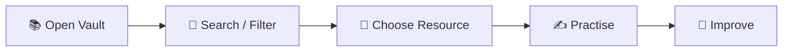
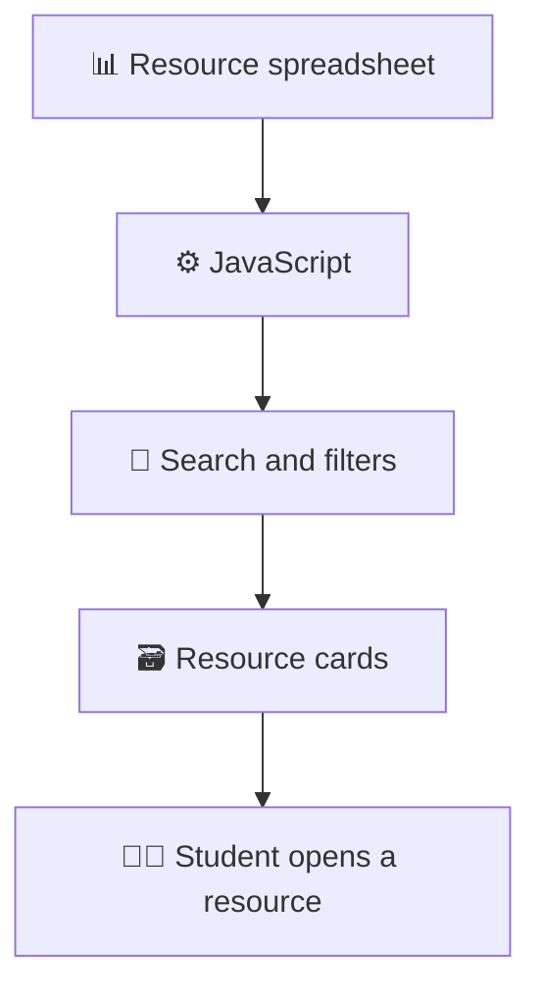

<!-- Animated header: the SVG animation is rendered by Capsule Render on GitHub. -->

 

**One place to discover study resources. More time to actually study.** 📚

---

## 👋 What is ICSE MasterClass?

ICSE MasterClass is a free, student-friendly website that helps ICSE Class 10 students **find and open study resources from one place**.

You can discover materials such as notes, question banks, previous-year questions (PYQs), sample papers, reference material and video lessons, depending on what is currently listed in the resource catalogue.

> **The simple idea:** spend less time searching and more time learning.

## 🚀 Start in 3 easy steps

| Step | What to do |
|---|---|
| **1. Open** | Visit the [Study Vault](https://icse-cbse-10-12.github.io/icse-class-10-materials/). |
| **2. Find** | Choose a subject, search for a topic, and use the available filters. |
| **3. Study** | Open a useful resource, practise questions, and revise what you learn. |

## 📖 What can you find?

- 📘 **Notes and revision material** — review topics and key ideas.
- ✍️ **Question banks** — practise questions by topic or chapter when available.
- 🧾 **Previous-year questions** — get familiar with past question styles.
- 📝 **Sample papers** — practise exam-style questions.
- 📚 **Textbooks and reference resources** — explore additional learning material.
- 🎥 **Video lessons** — learn with visual explanations.
- 🏛️ **Official resources** — follow links to relevant official material where listed.

*The catalogue changes over time. Always check the title, edition, syllabus relevance and original source before relying on a resource.*

## ✨ Helpful website features

- 🔎 **Search and filters:** narrow down the resources instead of scrolling through everything.
- 🗂️ **Organised resource listings:** find material using the subject and category details provided.
- 🔗 **Shareable links:** share a resource with a classmate when a share link is available.
- 📱 **Installable website:** supported browsers may offer an option to install the site like an app.
- 🎨 **Appearance settings:** use the available display options to make reading more comfortable.

## 🧠 A simple study routine

1. **Learn** the concept from class, notes or a video.
2. **Recall** the main points without looking at the material.
3. **Practise** chapter questions.
4. **Attempt** PYQs or sample-paper questions.
5. **Review** mistakes and revise weak topics.

<strong>💡 Why this order?</strong>

Reading helps you understand. Recall checks what you remember. Practice helps you apply it. Reviewing mistakes shows you what to revise next.

## ⚙️ How the website works

The website loads resource information from a published Google Sheets CSV feed. JavaScript uses those records to display resources and apply the available search and filter options.

This means resource listings can be updated in the data source without manually creating each card in the website code. External resources are hosted by their respective sources, not necessarily by this repository.

## 🧰 For developers and contributors

This is a lightweight website built with HTML, CSS and JavaScript, with Google Sheets providing the resource catalogue. The repository also includes Progressive Web App files and search-engine metadata.

| File | What it does |
|---|---|
| `index.html` | Main website page and page structure |
| `style.css` | Visual design and responsive styling |
| `script.js` | Loads and displays resource data; handles search and filters |
| `manifest.json` | Installable-app settings |
| `sw.js` | Service worker and caching behaviour |
| `404.html` | Custom page for missing URLs |
| `robots.txt` / `sitemap.xml` | Search-engine discovery settings |
| `LICENSE` | Source-code licence |

### Suggest a fix or improvement

1. Check the existing code before changing it.
2. Keep the site usable on mobile and desktop.
3. Test search, filters, links and display settings after changes.
4. Check resource details and links carefully.
5. Respect the ownership and licence terms of third-party material.

For resource feedback or corrections, use the [Telegram feedback channel](https://t.me/ICSEMasterClass10/1320). For copyright or takedown concerns, email **icsemasterclass@gmail.com** with the exact URL and details of the request.

## 🔗 Useful links

- 🌐 [Open the Study Vault](https://icse-cbse-10-12.github.io/icse-class-10-materials/)
- ▶️ [Watch ICSE MasterClass on YouTube](https://www.youtube.com/@ICSEMasterClass10)
- 💬 [Join the Telegram community](https://t.me/ICSE_Class10_WPIV)
- 🛠️ [View the GitHub repository](https://github.com/icse-cbse-10-12/icse-class-10-materials)

## ⚖️ Important notes

- ICSE MasterClass is an **independent educational project** and is not affiliated with or endorsed by CISCE.
- Third-party books, PDFs, videos, trademarks and other materials remain the property of their respective owners. A link does not mean this project owns or grants permission to redistribute the material.
- Resource availability and syllabus relevance can change. Check important details against the current CISCE syllabus, your teacher and the original source.
- The **MIT License applies to this repository's source code only**; it does not automatically apply to linked educational content. See [LICENSE](LICENSE).

---

### 📚 Learn. Practise. Improve.

**ICSE MasterClass — Study Smarter. Search Less. Achieve More.** 🚀

